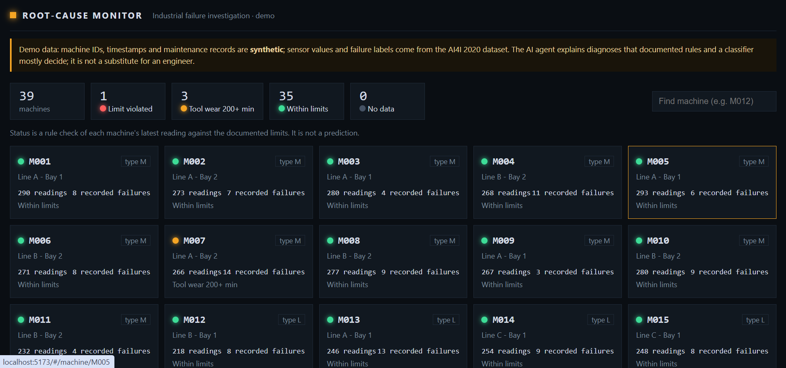
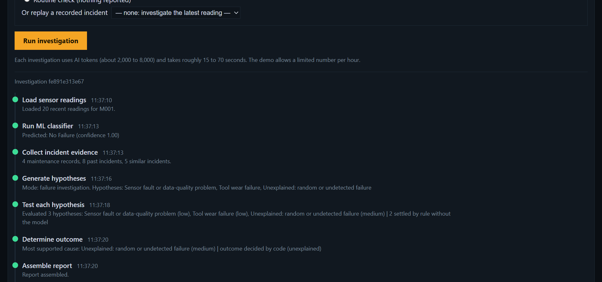
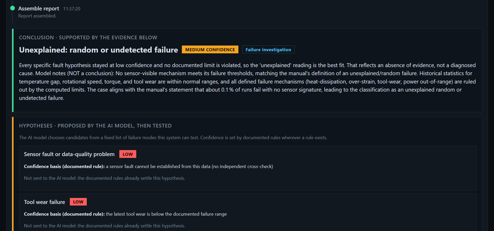
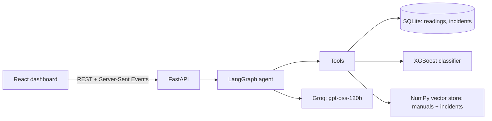
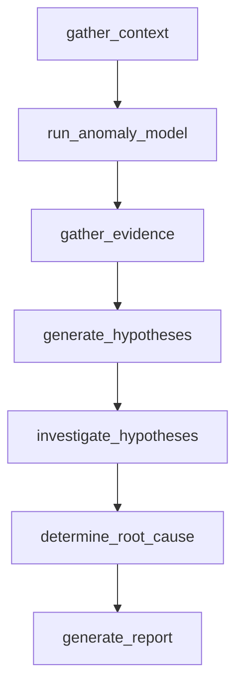

# Industrial Root-Cause Investigation Agent

An AI agent that investigates machine failures from sensor data, a trained classifier and technical manuals, then
writes an **evidence-backed report**. It keeps *observed facts*, *ML predictions*, *hypotheses* and *conclusions* apart,
and it answers **"unexplained"** when the evidence does not support a cause, instead of forcing a guess.

> **Read this first.** This is a portfolio project on a public benchmark dataset. Machine IDs, timestamps, maintenance
> records and the technical manuals are **synthetic**. It is not for real plants, and the evaluation is **partial**.
> See [Known limitations](#known-limitations) and [`docs/EVALUATION.md`](docs/EVALUATION.md).





## What it does

For a machine, the agent:

1. loads its sensor readings and runs an **XGBoost failure classifier**;
2. checks the **documented operating limits** (heat dissipation, power, overstrain, tool wear) in plain code;
3. asks a language model to propose hypotheses from a **fixed list** of failure modes the system can actually test;
4. tests each hypothesis against the readings, the manuals (retrieval) and similar past incidents;
5. decides the outcome and writes a report with the evidence for and against each hypothesis.

It runs in two modes: a **failure investigation** (something was reported) and a **health check** (routine, nothing reported).
In a health check, a tool with 200+ minutes of wear gets a *maintenance advisory*, not a diagnosis.

## The design idea: rules decide, the model explains

The first version let the language model rate its own confidence. On a 12-case pilot it named **4 of 10 incidents
exactly, against 9 of 10 for a simple rules-plus-classifier baseline**: it rated Tool Wear "high" on readings that broke
other limits, and once rated Heat Dissipation "low" although the documented limit was met.

So the design changed:

- **Documented rules set the confidence** wherever a rule exists. Every hypothesis shows its *confidence basis*.
- The model's own rating is **kept as a second opinion**. On the test run it was overruled in 22 of 27 hypotheses it evaluated.
- Hypotheses the rules already settle are **not sent to the model at all** (this also cuts tokens).
- Numbers the model writes are **checked against the evidence**; unverifiable ones are tagged in the report.
- The classifier is shown as *a prediction*, with a note whenever it disagrees with the conclusion.
- The synthetic maintenance records are **not shown to the model as evidence** (they are random).

## Architecture





The graph also contains a "gather more evidence" retry loop. It is **switched off** (`MAX_RETRIES = 0`): it only widens the
similar-incident list, which cannot change what the rules decide, and the pilot showed it only cost time.

## Results

Full details, method and caveats: **[`docs/EVALUATION.md`](docs/EVALUATION.md)**.

| | Incidents named exactly | False alarms on healthy readings |
|---|---|---|
| Baseline: documented limits + classifier (68 held-out incidents) | 60 / 68 (88%) | 29 / 1,932 |
| Agent, **partial** test run (26 incidents, 11 healthy) | 24 / 26 (92%, 95% interval 76% to 98%) | 0 / 11 |

- The agent **matches the baseline** on every case the documented rules cover, with 0 regressions. It names 3 more Tool Wear
  incidents (4 of 6 against 1 of 6) through a documented rule that a plain script could also apply. **It is not claimed to be
  more accurate.** What it adds is the written, evidence-backed explanation, an explicit "no fault" / "unexplained" outcome,
  and an audit trail of why each confidence was set.
- Only incidents the classifier **never saw** are scored; stored incident descriptions (which contain the answer) are hidden from the agent.
- The run covers **37 of 106 planned cases** and the sample is stratified, not random, so it is not an overall accuracy.

## Quick start

Requirements: Python 3.11, Node.js 18+, and a free [Groq](https://console.groq.com) API key for the AI agent.

### Backend

```bash
cd backend
python -m venv venv
venv\Scripts\activate            # Windows      (Linux/macOS: source venv/bin/activate)
pip install -r requirements.txt
copy .env.example .env           # Windows      (Linux/macOS: cp .env.example .env)  then put your GROQ_API_KEY in .env

python rag/03_build_vectorstore.py     # once: builds the manuals/incidents index (downloads an ~80 MB embedding model)
uvicorn api.main:app --port 8000       # interactive API docs: http://localhost:8000/docs
```

The database (`industrial_rca.db`) and the trained model are in the repository. To rebuild them:
`python database/01_setup_data.py` (downloads the dataset) and `python models/02_train_classifier.py`.

### Frontend

```bash
cd frontend
npm install
npm run dev                      # http://localhost:5173
```

### Recorded demo (no backend, no AI calls)

The dashboard can run from saved JSON, replaying the 37 recorded investigations of the frozen agent. This makes it
hostable on any static host.

```bash
cd backend && python evaluation/09_export_demo.py
cd ../frontend && npm run build:demo        # static site in frontend/dist
```

### Cost and limits

An investigation uses about 2,000 tokens (health check) to 8,000 (failure investigation) and takes roughly 15 to 70 seconds.
Groq's free plan allows about 200,000 tokens a day for this model. The API runs one investigation at a time and caps them per
hour (`DEMO_MAX_PER_HOUR`). All settings are listed in [`backend/.env.example`](backend/.env.example).

## API

| Endpoint | Purpose |
|---|---|
| `GET /machines`, `GET /machines/{id}` | Fleet and machine detail, with a rule check of the latest reading |
| `GET /machines/{id}/sensors`, `/maintenance`, `/incidents` | Time-ordered data for charts and history |
| `POST /investigations` | Start an investigation (returns 202 and an id) |
| `GET /investigations/{id}` | Status, timeline so far and the report |
| `GET /investigations/{id}/events` | Live timeline as Server-Sent Events |

The API never writes to the database. It can investigate "as of" a past moment (`as_of`) and hide one incident from the
agent's own evidence (`incident_id`), which is how the evaluation replays recorded incidents without leaking the answer.

## Tests

None of these call the AI or use tokens.

```bash
cd backend && python run_all_tests.py      # checks, agent control flow, runner, evaluation scoring, API, time-travel
cd frontend && npm test                    # components, report rendering, live-timeline logic
```

## Reproduce the evaluation

```bash
cd backend
python evaluation/08_make_eval_sets.py     # reconstructs the held-out split, leak check, case list
python evaluation/08_baseline.py           # baseline without a language model
python evaluation/08_run_agent.py          # calls the AI; resumable; stops by itself at the daily token limit
python evaluation/08_report.py             # agent versus baseline on the same cases
```

## Project layout

```
backend/
  api/          FastAPI app, request/response models, background investigation runner
  graph/        the agent: state, nodes, deterministic checks (checks.py), graph assembly
  tools/        the seven investigation tools the agent calls
  database/     dataset loader (01_setup_data.py) and SQL helpers
  models/       classifier training and prediction
  rag/          manuals (synthetic), loaders, vector store, retrieval
  evaluation/   leak-free evaluation harness, baseline, recorded results, demo exporter
  test_*.py     unit and control-flow tests
frontend/       React + TypeScript dashboard (Vite, Recharts)
docs/           EVALUATION.md and images
```

## Known limitations

- **Synthetic parts.** Machine IDs, timestamps, maintenance records and the technical manuals are synthetic. Sensor values and
  failure labels are real (AI4I 2020). The readings of one machine are independent samples, **not a time series**, so the agent
  never reasons about trends and decides on the latest reading only.
- **Tool Wear and Random failures cannot be detected reliably from these sensors.** About 95% of readings at 200+ minutes of
  wear are healthy. The agent names Tool Wear at *medium confidence at most*, and only when a failure was reported.
- **The "Unknown" label** (failures with no recorded cause) is an upstream dataset quirk and is reported as "unexplained".
- **The overstrain rule uses the lowest quality limit** and can over-flag (this produced the one confident error, `inc-72`).
  The machines table has a `machine_type`; whether it matches each reading's product quality has not been verified.
- **The classifier can mislead the agent**: when it names a cause whose documented limit is not met, the agent gives that cause
  *medium* confidence (this cost `inc-199`). A stricter design would not let it.
- **The test run is partial** (37 of 106 planned cases, stopped by a free-tier token limit), the sample is stratified, and
  per-class counts are tiny (6 Tool Wear, 1 Unknown, 1 compound). Compound failures are barely tested.
- **Maintenance records are not used as evidence** because they are random. Whether they would help or hurt was not measured.
- The agent uses one hosted model (`openai/gpt-oss-120b` on Groq). Results can vary between runs, although temperature is 0 and
  the decisions that matter are made by code.
- **Not a safety system.** It is an explanation aid on benchmark data, not a substitute for an engineer.

## Troubleshooting

- **`onnxruntime` or `chromadb` crashes on import on Windows** (an "access violation"). On the author's machine, newer builds
  crashed and the versions pinned in `requirements.txt` worked (`onnxruntime` 1.19.2 and `chromadb` 0.6.3). `chromadb` is used only
  for its embedding model; the vector search itself is plain NumPy.
- **`429` or "tokens per day" errors:** Groq's free quota is used up. The evaluation runner stops by itself and tells you how long to
  wait; the API reports a friendly message.
- **The dashboard says it cannot reach the API:** start `uvicorn api.main:app --port 8000`, or set `VITE_API_URL` in `frontend/.env`.

## Data and credits

Sensor data and failure labels: *AI4I 2020 Predictive Maintenance Dataset*, UCI Machine Learning Repository (dataset id 601).
Please see the dataset page for its citation and license terms.
